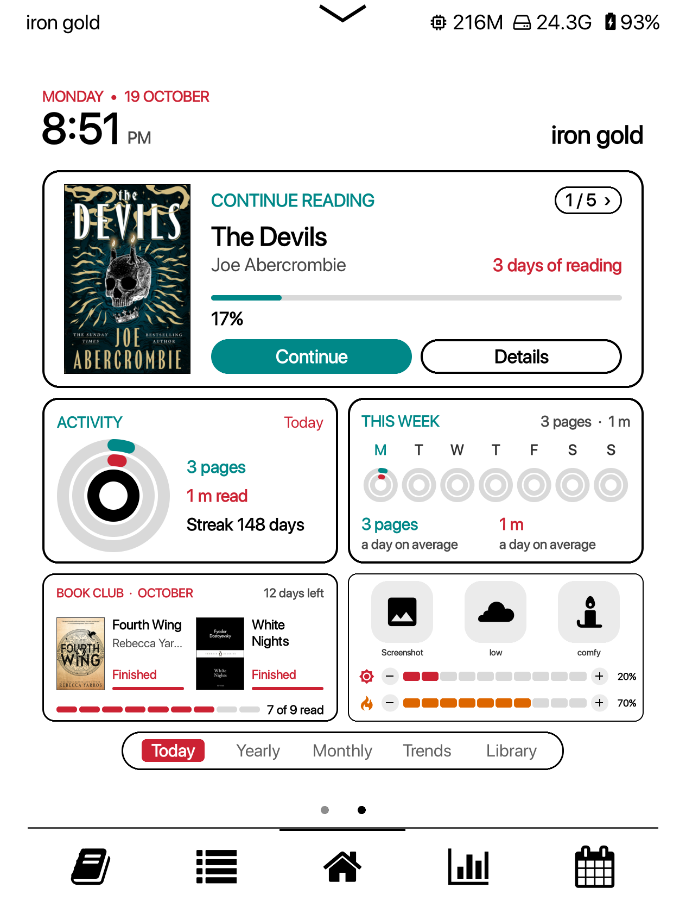
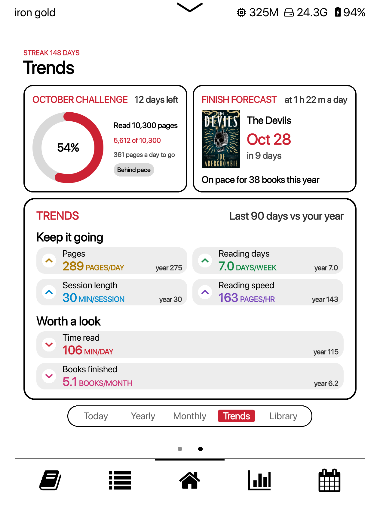
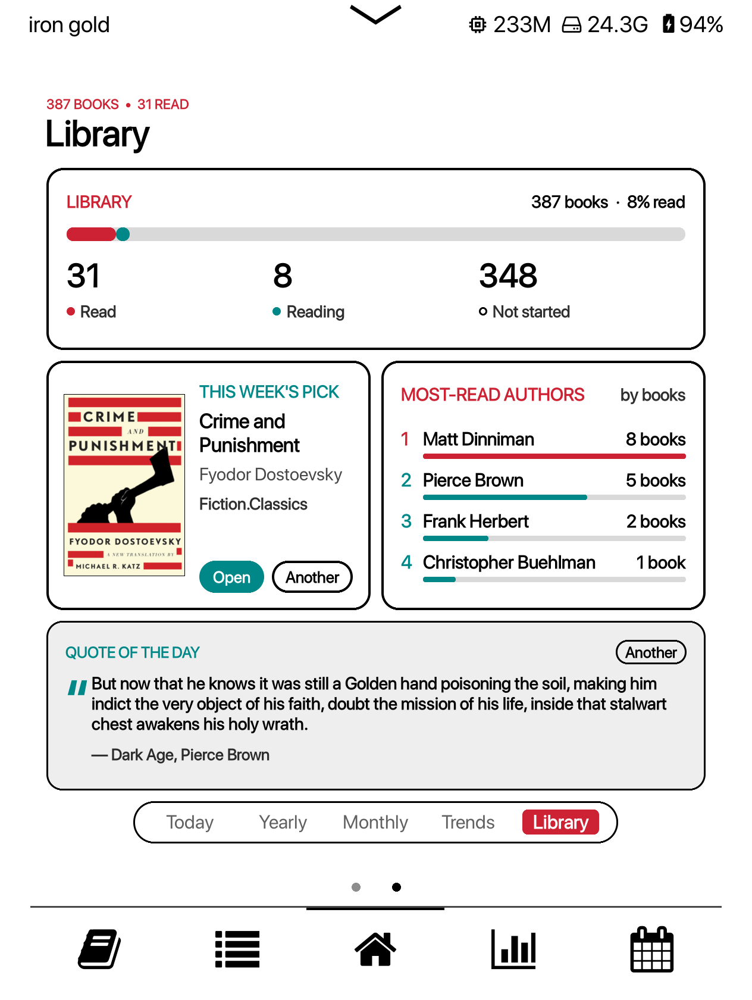
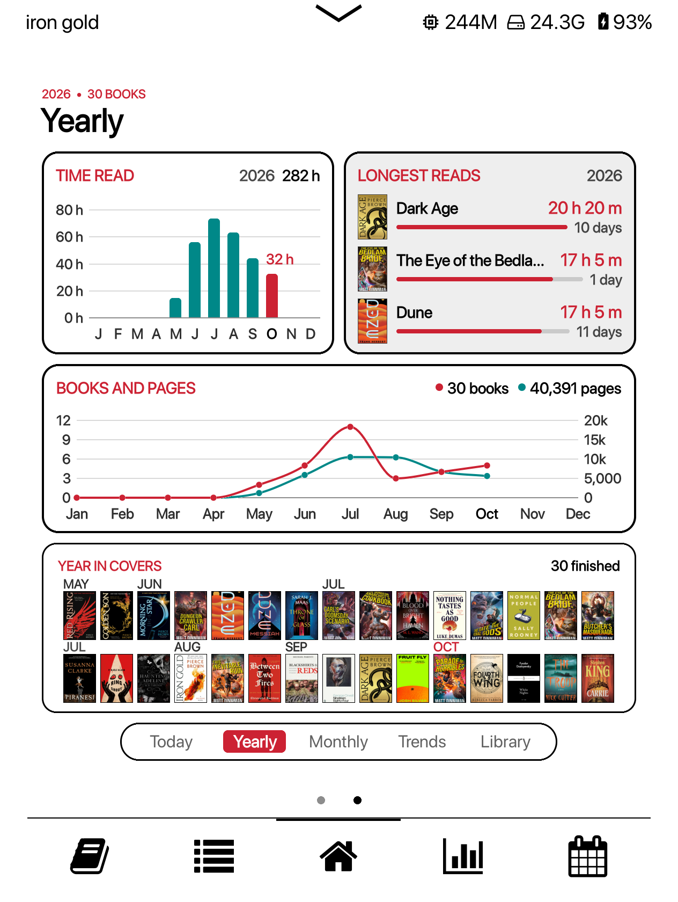
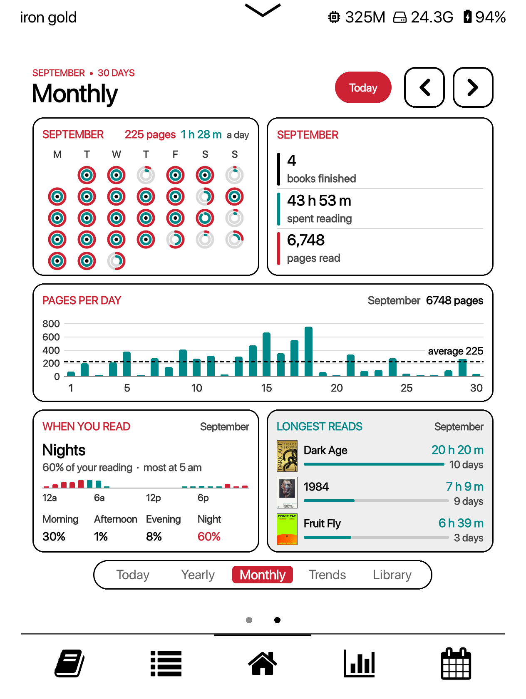

# Reading Log for Simple UI

**Reading dashboard cards for KOReader's [Simple UI](https://github.com/doctorhetfield-cmd/simpleui.koplugin) home screen.**

Activity rings, monthly and yearly charts, reading trends, a monthly
challenge, finish forecasts, library stats, a random pick from your unread
books, your own highlights, a Control centre and more: 36 cards, a Mini
dashboard, and a tabbed Dashboard that puts them together. No Bookshelf
needed.

This is the Simple UI version of [Reading Log for Bookshelf](https://github.com/stevenzamora1/reading-log).

  
  
  

## Screenshots

| Today | Yearly | Monthly |
| :---: | :---: | :---: |
|  |  |  |
| The time, Continue reading, today's rings, the week, the book club and the Control centre | Time read, longest reads, books and pages by month, and every cover you finished this year | Month rings, the month's totals, pages per day, when you read, and longest reads. Step back up to twelve months |

| Trends | Library | On the home screen |
| :---: | :---: | :---: |
|  |  |  |
| The monthly challenge, finish forecast, and your last 90 days against your year | Library stats, this week's random pick, most-read authors and a quote from your highlights | Cards on their own, alongside Simple UI's own modules |

## What you need

- [KOReader](https://koreader.rocks) with [Simple UI](https://github.com/doctorhetfield-cmd/simpleui.koplugin) **2.7.5 or newer**.
- KOReader's **Reading statistics** plugin switched on (it is by default). All the reading figures come from it.
- Bookshelf is **not** needed. A colour screen is optional; on a black-and-white screen the colours show as greys.

## Install

1. Download `readinglog-simpleui-1.3.0.zip` from [Releases](../../releases) and unzip it.
2. Copy the `readinglog.koplugin` folder into KOReader's `plugins` folder:
   - Kobo: `.adds/koreader/plugins/` (`.adds` is hidden: in macOS Finder press <kbd>Cmd</kbd>+<kbd>Shift</kbd>+<kbd>.</kbd>; in Windows Explorer choose View > Show > Hidden items)
   - Kindle: `/mnt/us/koreader/plugins/`
   - Android: `<koreader folder>/plugins/`
3. Eject the e-reader and restart KOReader.

**Updating:** Tools > Reading Log > **Check for updates** (see [Updates](#updates)), or replace the folder by hand and restart. Your settings are kept (they live in `settings/readinglog.lua`, outside the plugin folder).

## Updates

KOReader menu > Tools > **Reading Log** > **Check for updates** looks for a newer release here, shows what's new, and installs it when you say so (connect to Wi-Fi first, or KOReader will offer to). Restart KOReader afterwards. Your settings are kept.

Turn on **Check for updates automatically** to have it look once a day when you're already online. It tells you when there's a new version and never installs one without asking.

## Add cards

Simple UI Settings > **Home Screen** > **Layout Editor**, open a page, tap **Add Module**, and pick any `Reading Log · …` module. Set a card's Column Width to 50% (long-press > Column Width) to put two side by side.

Long-press any card for its settings.

## The cards

| Today | Monthly | Yearly |
| --- | --- | --- |
| Banner (time and date) | Cover calendar | Time read by month |
| Continue reading | Month rings | Longest reads of the year |
| Activity rings | Month totals | Books and pages by month |
| Week rings | Pages per day | Year in covers |
| This week | When you read | Reading heatmap |
| Week in covers | Longest reads of the month | Top genres |
| Year goal | Monthly challenge | Recently finished |
| Book club | | |
| Today's timeline | | |
| Control centre | | |

| Trends | Library | Shelves |
| --- | --- | --- |
| Reading trends | Library stats | TBR shelf |
| This week vs last | Most-read authors | Finish by |
| Finish forecast | Random pick | |
| | Quote of the day (1 to 4) | |

### New in 1.3

- **Cover calendar**: every day of the month with the cover of the book you read most that day and the time read under it, a second book fanned out behind it, and the month's pages, books and time along the top. Tap a day for its books. **Today** jumps back to this month. It has its own Dashboard tab, **Calendar**.
- **Week in covers**: this week's days with their covers in one row, as a card or a small card in the Mini dashboard.
- **Quote of the day 2, 3 and 4**: more quote cards, each with a random highlight of its own, never the same one as your other quote cards. Another on one doesn't change the others.
- **Style: Default or Cute** (Dashboard settings, or Look and colours on any card): every cute look at once. See [Cute style](#cute-style).
- **Hearts instead of rings** for Activity rings, Week rings, Month rings and the Mini dashboard.
- **Control centre**: a button can show a PNG or JPEG picture of your own instead of an icon: just the picture, with no tile behind it (its name turns the accent colour while the button is on).
- Covers in the polaroids and the scrapbook are sharpened, and the Dashboard has room for 8 tabs.
- **Wallpaper**: cards on their own over a see-through wallpaper are drawn as solid cards, like the Dashboard's, instead of putting their text straight onto the picture.
- **Faster**: a card that hasn't changed is copied back from memory instead of drawn again (going back to a tab, the minute redraw), the Cute drawings draw two to four times faster, and a tab is drawn whole in one go instead of filling in a moment later.
- **Easier on the battery**: turning a Dashboard tab gets a quick screen update instead of a flash (KOReader still flashes every so often, by its own Full refresh rate), and the minute redraw does about half the work.

### New in 1.2

- **Spanish, French, Brazilian Portuguese and Italian**, following KOReader's language. Numbers, dates and plurals follow the language too, and each language is one file you can add to (translation system and Italian by [DevGizmo86](https://github.com/DevGizmo86), from [Reading Log for Bookshelf](https://github.com/stevenzamora1/reading-log)).
- **Wallpaper**: the Dashboard follows Simple UI's Background Opacity.
- **Tab names** that are too long for their tab get smaller instead of being cut off.
- **Today's timeline** follows KOReader's 12/24-hour setting.
- **Check for updates** from the Reading Log menu, and install them in one tap.

### New in 1.1

- **Reading trends**: your last 90 days against your year (time, pages, reading days, session length, speed, books finished).
- **Monthly challenge**: one goal for the month, picked from your last three months or set by you.
- **Finish forecast**: when you'll finish the books you're reading at your recent pace, and where your year is heading.
- **This week vs last**: your average a day this week against last week (or month, or year).
- **Today's timeline**: each sitting today on a line through the day.
- **Control centre**: up to 8 buttons for any action, with brightness and warmth.
- **Library stats**, **Most-read authors**, **Random pick** (only the next book of a series) and **Quote of the day** (from your own highlights).
- **Mini dashboard**: one row of up to three small cards for the top of the home screen.
- **Dashboard**: Trends and Library pages, up to 7 tabs, move tabs, remove pages you added, reset the whole Dashboard.
- **Text size** for every card and for the whole Dashboard.
- **Finish dates**: a book reopened for a moment no longer moves to today's date.

## The Dashboard

The Dashboard puts the cards together as tabbed pages (Today, Yearly, Monthly, Trends, Library and Calendar) and is meant to fill a screen on its own.

1. Simple UI Settings > **Extra Custom Screens**: create one (call it "Reading Log", say). Simple UI gives it a Quick Action, so you can put it on the navigation bar.
2. Open its layout and add **Reading Log · Dashboard** on its own.
3. Long-press the Dashboard and set **Top Margin** to 0 and **Height** to Fill the page.

Tap the tabs to switch pages. On the Monthly page the arrows step back one month at a time, and every card on the page follows.

Long-press > **Pages and cards…** to change it: any card on any page, one or two cards per row, row heights, tab names, pages shown or hidden, **+ Add a page** (up to 8 tabs), **Move tab left / right**, and **Remove this page**. **Put the whole Dashboard back as it came…** resets the layout and keeps each card's settings and the colours.

## The Mini dashboard

**Reading Log · Mini dashboard** is one row of up to three small cards. It starts with the book you're reading and today's rings, then the Control centre. Long-press > Content to swap in Continue reading, Activity rings, This week vs last, Week rings, Week in covers, Monthly challenge, Finish forecast, Year goal, Today's timeline, Random pick, Quote of the day or Library stats.

## Cute style

**Style: Cute** (long-press the Dashboard, or Look and colours on any card)
turns on every cute look at once. **Default** puts them all back. Each card
can still be changed on its own: long-press it > Content.

| Card | Cute look |
| --- | --- |
| Activity rings, Week rings, Month rings, Mini dashboard | Two hearts that fill up from the bottom: the outer one with pages, the inner one with time. A day that misses its goals gets a broken heart. Pink, or in the card's colours |
| Monthly challenge | A peony whose petals colour in as you get closer to the month's goal, with sparkles when it's done |
| Book club | A garden: each progress bar grows as a vine with leaves and a bud, and finished covers get a dragonfly sticker |
| Year goal | A jar that fills with a heart per book finished. Past the goal the lid pops off and the hearts heap over the rim ("Goal reached, +3") |
| Quote of the day (all four) | Lined notebook paper with a margin line, punched holes and washi tape |
| Cover calendar, Week in covers | Polaroids: each cover in a white frame, a little tilted, with the time read written on it |
| Continue reading | A scrapbook: the cover as a taped polaroid and the progress bar as a vine |
| Reading trends | Sticky notes with washi tape and a folded corner, a sprout, drooping leaf or sun instead of arrows, and a highlighter swoosh under each figure |
| Bar and line charts | Bars as book spines on a shelf with a heart on the best one; lines with a soft hill, hearts on the points and a flower on the latest |
| Today's timeline | A sky from sunrise to night: clouds for daytime sittings, stars for evening ones, and a heart over now |
| Finish forecast | A desk calendar: the finish date on a tear-off page with the day circled in a heart, and date stickers for your other books |

## Settings

Long-press a card. Next to Simple UI's own Frame, Background, Top Margin and Column Width:

- **Content**: the card's own options (goals, collections, how many books, the banner's lines, the book club's picks, the challenge target, …).
- **Appearance**: **Card height**, **Text size** (70–150%), **Card colour**, and **Look and colours** for all cards at once: theme (White, Dark or Paper), Style (Default or Cute), two accent colours from twelve, how cards look on their own, and the day the week starts on.
- **When tapped**: the card's own action, the reading calendar, reading progress, or any Simple UI Quick Action.

**Control centre buttons:** long-press > Content > tap a button. **Action…** picks a KOReader action (Wi-Fi, night mode, light, rotate, calendar, sleep, search, last book, history, favorites, …) or any Simple UI Quick Action; **Icon…** picks one of 37 icons, or **Use a picture** shows a PNG or JPEG of your own; **Name** renames it.

## Languages

The cards, the Dashboard and their settings follow KOReader's language
(Settings > Language): **English**, **Italian**, **Spanish**, **French** and
**Brazilian Portuguese** (also used for Portuguese from Portugal). Numbers,
dates, day and month initials and plurals follow the language too (14.894
and "1 libro / 2 libros" in Spanish, for example). Book titles, authors,
genres and names you type in are shown as they are. Restart KOReader after
changing the language.

Each language is one file in `readinglog/locales/`. To add one, see
[TRANSLATING.md](readinglog.koplugin/TRANSLATING.md).

## Wallpaper

With a Simple UI wallpaper on, the Dashboard follows its **Background
Opacity** (long-press > Background). Below Solid, the wallpaper shows around
and between the cards; the cards and the tab bar stay solid so they stay
readable, and the date, time and page titles at the top get a plate behind
them. Cards on their own do the same: below Solid, each one is a solid card
with the wallpaper around it.

## Shared with Simple UI

- **Goals**: the year's book goal and the daily minutes goal are Simple UI's Reading goals. Change them in either place.
- **Books finished** are counted the way Simple UI's Reading goals count them, so the numbers agree.
- **Books**: titles and authors include your custom metadata, covers come from Simple UI's cover cache, and "Details" opens Simple UI's book menu.
- **Your library**: Library stats, Most-read authors and Random pick count the books under KOReader's home folder. Titles, authors, series and genres come from the cover browser, so a book it hasn't seen yet shows its file name.
- **Highlights**: Quote of the day picks one highlight a day from the books in your history. Another gives the next.

## Coming from Reading Log for Bookshelf

On the first start, your Bookshelf-version settings (theme, accents, collections, book club picks, Dashboard pages, card colours) are copied across. Both versions can be installed at once.

## Troubleshooting

- KOReader menu > Tools > Reading Log > **About** shows whether Simple UI was found.
- Look and colours > **Diagnostics** shows the versions, theme and screen.
- Problems are logged to `crash.log` with `[readinglog]`.
- Wrong language? `crash.log` has a `[reading-log i18n]` line saying which language Reading Log found and which file it used.

## Credits

- [u/fishnoogz](https://www.reddit.com/user/fishnoogz/) on Reddit, whose post inspired the ring designs and the dashboard idea.
- [Simple UI](https://github.com/doctorhetfield-cmd/simpleui.koplugin) by Doctor Hetfield, which these modules plug into.
- [Bookshelf](https://github.com/AndyHazz/bookshelf.koplugin) by AndyHazz, where the cards started.
- [BrownTigerz (TK)](https://github.com/BrownTigerz/simpleui_readinglog.koplugin), whose finish-date correction this version uses.
- [DevGizmo86](https://github.com/DevGizmo86), for the translation system and the Italian translation.
- [KOReader](https://github.com/koreader/koreader) and its Reading statistics plugin.

Made by Steven ([@stevenzamora1](https://github.com/stevenzamora1)).

## License

[AGPL-3.0](LICENSE), the same licence as KOReader.
